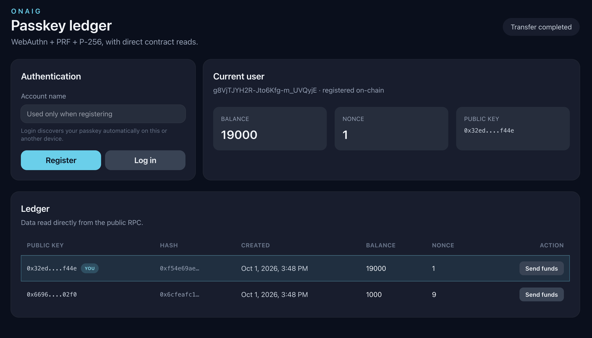

# ONAIG

**Giano** reversed.  
Passkey authentication for EVM transactions leveraging:
- RIP-7212 (P256 signature verification)
- ERC-4337 (account abstraction for smart wallets)
- ERC-7677 (paymaster)

Live demo here: https://onaig-passkey.duckdns.org



## Development

Setup:
```sh
fnm install
npm install -g corepack
corepack enable
corepack install
pnpm install
pnpm env:down
pnpm env:up
```

Linting:
```sh
pnpm lint
pnpm tsc
```

Testing:
```sh
pnpm -r test
```

To develop:
```sh
pnpm -F passkey bc:compile
pnpm -F passkey api
pnpm -F passkey dev
# start ngrok!
# npx ngrok start --all --config ./ngrok.yml --authtoken <token>
```

To demo:
```sh
pnpm -F passkey bc:compile
pnpm -F passkey api
pnpm -F passkey build
pnpm -F passkey preview
# start ngrok!
# npx ngrok start --all --config ./ngrok.yml --authtoken <token>
```